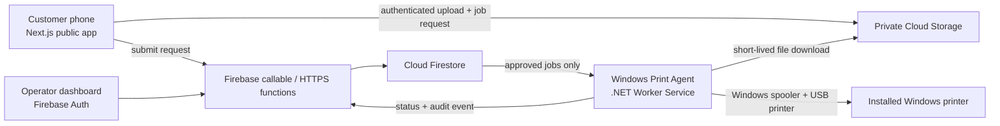
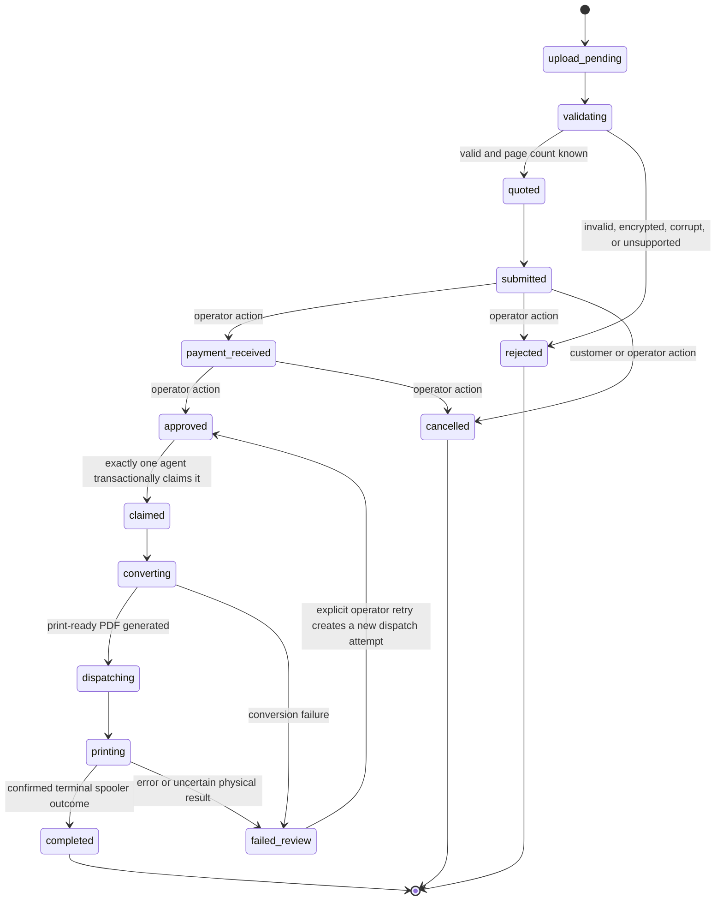

# CyberPrint Pay Implementation Plan

## 1. Goal and service boundary

CyberPrint Pay will be a separate service area within the existing Paperloop site, not an extension of the browser-only print-preparation tool.

It will provide a safe workflow for a cybercafé:

1. A customer scans a QR code and creates a print request.
2. The service validates and privately stores the file.
3. The backend determines printable pages and calculates the price.
4. The customer receives a queue number and **no print job is released yet**.
5. An authenticated operator receives payment manually, then approves or rejects the request.
6. A local Windows print agent claims only an approved job, converts it when necessary, and sends it to the USB-connected printer.
7. The agent reports unambiguous outcomes. Any uncertain physical result requires operator review and cannot be automatically retried.

The public service must never connect directly to the Windows printer or local network.

## 2. Recommended smallest reliable architecture

Use Firebase for the managed service and a small .NET 8 Windows Worker Service for the on-site agent.



### Components

| Component | Responsibility | Keep it small |
|---|---|---|
| Next.js app | Customer QR landing page, submission, status tracking, operator dashboard | Existing application, add routes under `/print` and `/operator` |
| Firebase Authentication | Operators sign in with email/password or Google Workspace | Customers use anonymous session plus a one-time queue token |
| Cloud Storage for Firebase | Private original uploads and converted PDFs | Upload size/type restrictions and retention cleanup |
| Firestore | Jobs, printer agents, audit events, pricing configuration | Source of truth for job state |
| Cloud Functions for Firebase, 2nd gen | Validate requests, calculate price, issue one-time agent claim/download grants, enforce state changes | All sensitive pricing and lifecycle updates run here |
| Windows agent | Conversion, printer configuration, spooler monitoring, secure status reporting | .NET 8 Worker Service, runs as a restricted Windows service |
| LibreOffice headless | Converts supported office files to PDF | Install only on the Windows print computer |

Firebase Storage supports client uploads governed by Storage Security Rules, while privileged server code can manage buckets and access files through the Admin SDK. Firestore transactions can perform atomic state updates, which is essential for approval and agent-claim idempotency.

## 3. Scope: build in two stages

### Stage A: reliable print MVP

Support the formats and print modes that can be reliably processed immediately.

| Category | Stage A support | Handling |
|---|---|---|
| PDF | Yes | Validate PDF, count pages, render a preview, send PDF directly to the agent |
| Images: JPG, JPEG, PNG, WebP, BMP, TIFF | Yes | Server validates image metadata, agent converts to single-page PDF |
| Plain text: TXT | Yes | Agent converts to PDF with a fixed, documented layout |
| CSV | Yes, optional in Stage A | Convert with LibreOffice if installed and tested |
| DOC, DOCX, ODT, RTF | Yes, only after local LibreOffice validation | Convert to PDF on agent before spooler submission |
| XLS, XLSX, ODS | Yes, only after local LibreOffice validation | Convert to PDF, reject if conversion fails |
| PPT, PPTX, ODP | Yes, only after local LibreOffice validation | Convert to PDF, reject if conversion fails |
| Password-protected, encrypted, corrupted, macro-based, or unsupported files | No | Reject with a specific user-facing reason. Do not claim page count or price. |

Do not advertise a format until the configured agent has passed a conversion fixture for it. The dashboard should show the agent's actual conversion capabilities, including installed LibreOffice version and disabled formats.

### Stage B: operational enhancements

- Multiple printer profiles and paper trays
- Print preview thumbnails and per-page selection for PDFs
- Configurable shop rates, taxes, and discount rules
- Agent auto-update process with operator-controlled maintenance window
- QR creation and printable counter placard
- Multi-agent support for more than one cybercafé PC

## 4. Explicit pricing and printing rules

### Pricing model

Initial shop rates:

- Black and white: **₹5 per printed side**
- Colour: **₹10 per printed side**

The backend owns the calculation. The browser only displays a quote.

```text
selectedPrintablePages = unique valid pages in requested range
printedSides = selectedPrintablePages × copies
amount = printedSides × rate(printMode)
```

### Page range rules

- `all` selects all discovered printable pages.
- Accept a compact range grammar such as `1-3,5,8-10`.
- Reject invalid, repeated, out-of-bounds, or excessively large ranges server-side.
- Persist the normalized sorted page list and the page-count snapshot with the job.
- A change to file, range, copies, mode, paper, orientation, or duplex creates a new server-side quote revision.

### Colour rules

- **MVP policy:** a job is wholly B/W or wholly colour, selected by the customer and confirmed by the operator.
- Do not auto-detect mixed-colour PDFs for billing in the initial version. That is unreliable across source formats and can create billing disputes.
- A later optional mode may add an operator-reviewed per-page colour classification, but the default remains one mode per job.

### Duplex rules

- Duplex is off in the first customer release unless the printer profile explicitly reports reliable duplex support.
- Billing remains **per printed side**, not per physical sheet. A four-page, one-copy duplex job is billed for four sides.
- The agent must reject duplex if the printer configuration cannot apply it. It must never silently fall back to simplex while preserving a duplex quote.

## 5. Firestore data model

```text
shops/{shopId}
  name, currency, timezone, activePricingVersion, retentionHours

shops/{shopId}/pricing/{pricingVersion}
  bwPerSidePaise: 500
  colourPerSidePaise: 1000
  allowedPaperSizes: [A4]
  duplexEnabled: false

shops/{shopId}/jobs/{jobId}
  queueNumber: "CP-1042"
  publicStatusTokenHash
  customerSessionIdHash
  originalFile: { storagePath, originalName, bytes, mimeType, sha256 }
  normalizedDocument: { status, storagePath?, pageCount?, conversionError? }
  request: { pageSelection, pages[], copies, paperSize, orientation, printMode, duplex }
  quote: { pricingVersion, printedSides, unitPricePaise, totalPaise, quotedAt }
  status
  approval: { approvedBy?, approvedAt?, paymentMethod?, paymentReceivedAt? }
  claim: { agentId?, claimId?, claimedAt?, expiresAt? }
  dispatch: { dispatchId?, spoolerJobId?, dispatchedAt? }
  result: { completedAt?, failedAt?, failureCode?, physicalOutcome }
  createdAt, updatedAt, expiresAt, version

shops/{shopId}/agents/{agentId}
  displayName, enabled, lastHeartbeatAt, printerProfiles, capabilities, agentPublicKey

shops/{shopId}/jobs/{jobId}/events/{eventId}
  eventType, actorType, actorId, requestId, previousStatus, nextStatus, at, metadata

shops/{shopId}/dailySummaries/{yyyy-mm-dd}
  jobsSubmitted, jobsApproved, jobsCompleted, jobsFailed, cashPaise, upiPaise, totalPaise
```

Use immutable event records for auditability. The `jobs` document is the current projection, while `events` explains who performed each transition and when.

## 6. Required state machine and idempotency



### Hard rules

1. Only the server changes price, queue number, approval, claim, and dispatch fields.
2. Only an operator can transition `submitted` to `payment_received`, `approved`, `rejected`, or `cancelled`.
3. Agent claim uses one Firestore transaction: status must equal `approved`, no unexpired claim may exist, and the agent must be enabled.
4. Each agent dispatch has an idempotency key. Repeating the same request returns the original outcome instead of printing twice.
5. Any failed or interrupted dispatch becomes `failed_review`, not `approved` and not `completed`.
6. Retrying requires an operator confirmation and creates a new `dispatchAttempt` event. The agent must not infer that a previous physical print did not happen.

Firestore transactions are atomic and retry on concurrent changes, so use them for all transitions that must not partially apply, especially approval, agent claim, and daily summary updates.

## 7. API surface

Use callable HTTPS functions for browser-facing actions and authenticated HTTPS endpoints for the agent.

### Customer actions

- `createCustomerSession()` returns an anonymous session and upload intent.
- `startUpload()` validates requested metadata and returns the private upload path.
- `finalizeUpload(jobDraft)` validates file metadata, requests page analysis, and returns a server quote or explicit rejection.
- `submitJob(jobId, quoteRevision)` transitions `quoted -> submitted` and returns a queue number plus public tracking token.
- `getPublicJobStatus(queueNumber, token)` returns sanitized status only, never the file URL or private metadata.

### Operator actions

- `listQueue(shopId)` streams sanitized job data for authenticated operator users.
- `recordPayment(jobId, paymentMethod, requestId)` idempotently records cash or UPI receipt.
- `approveJob`, `rejectJob`, `cancelJob`, and `retryJob` all require operator authentication, reason where applicable, and a request ID.
- `getDailySummary(shopId, day)` returns server-calculated counts and revenue.

### Agent actions

- `heartbeat()` reports service version, installed printer profiles, converter capabilities, and last spooler health.
- `claimNextApprovedJob()` claims one job transactionally. Do not poll public Firestore directly from the agent.
- `getClaimedJobDownload(jobId, claimId)` validates the active claim then returns one short-lived signed URL or streams the converted artifact.
- `reportConversionResult`, `reportDispatchStarted`, and `reportDispatchResult` validate the active claim and dispatch idempotency key.

Callable functions can automatically include Firebase Auth and App Check tokens when available, and Firebase recommends App Check to reduce abuse.

## 8. Firestore and Storage security rules design

### Customer access

- Anonymous customer users may create only their own upload draft and may read only their own sanitized status document.
- The client cannot write price, page count, approval, agent claim, file storage path, printer settings, audit events, or final job status.
- File upload writes are allowed only under the server-created session path, only before expiration, only within the configured byte limit, and only for an allow-listed MIME type. The server rechecks magic bytes after upload.
- Customer download access is denied. Customer originals are never given a public URL.

### Operator access

- Require Firebase Auth plus a custom claim such as `operator: true` and a shop membership document.
- Permit dashboard reads needed for the assigned shop, but route status-changing actions through server functions instead of direct Firestore writes.

### Agent access

- Do not use a long-lived Firebase service-account key in the agent.
- Give each agent an enrollment secret once, exchange it for short-lived credentials, rotate credentials, and allow server endpoints only from enrolled, enabled agents.
- Agent download URLs are short-lived, single-claim scoped, and unusable after dispatch completion or claim expiry.

Firebase Storage rules evaluate access using request and resource metadata, and Firestore/Storage rules should be paired with Authentication and App Check rather than relying on client input.

## 9. Windows print agent design

### Technology

- **Runtime:** .NET 8 Worker Service
- **Installation:** MSI or `sc.exe` managed Windows service
- **Service account:** non-administrator local service identity with access only to the selected printer, spooler, conversion folder, and the agent config directory
- **Configuration:** agent ID, enrollment token reference, shop ID, selected printer profile, file limits, LibreOffice path

### Agent loop

1. Send heartbeat every 30 to 60 seconds.
2. Ask backend for at most one approved job.
3. Persist a local encrypted dispatch journal before downloading or printing.
4. Download the claimed original through a short-lived URL.
5. Validate SHA-256 against backend metadata.
6. Convert non-PDF supported files to a temporary PDF with LibreOffice headless.
7. Reopen the PDF with a trusted local renderer and verify page count against the server quote snapshot.
8. Apply printer profile settings: paper size, orientation, colour or monochrome, copies, and duplex only when supported.
9. Submit one print job with a unique spooler title containing the backend dispatch ID.
10. Monitor the Windows spooler and report only observed states.
11. Securely delete temporary originals/conversions after report or on next startup recovery.

Windows provides PrintManagement tooling for printer configuration and spooler job inspection, including `Get-Printer`, `Get-PrintConfiguration`, and `Get-PrintJob`. Agent implementation should map capabilities to each installed driver rather than assuming every driver accepts all requested settings.

### Agent safety requirements

- No inbound port, remote desktop exposure, or printer sharing to the internet.
- Outbound HTTPS only.
- Explicit printer allowlist by installed printer name and driver ID.
- Conversion and rendering run with timeouts, byte limits, page limits, and a restricted temp folder.
- Treat failed spooler monitoring, PC sleep, agent restart, paper jam, printer offline, or driver error as `failed_review` unless completion is unambiguous.
- Never silently retry a job after a process restart.

## 10. Customer and operator UX plan

### Customer routes

- `/print`: fast QR landing page, pricing card, upload control, settings, and quote.
- `/print/job/[queueNumber]`: queue number, current sanitized status, and a refresh-safe tracking token stored locally.

Customer form fields:

- File upload, drag/drop where browser supports it
- Filename, byte size, detected file type, validation result
- Page count and parsed range input once analysis completes
- Copies, A4 initially, portrait or landscape, B/W or colour
- Duplex toggle only when shop exposes it
- Server-returned price breakdown
- Submit button disabled until the quote revision matches current selections

### Operator routes

- `/operator/login`
- `/operator/queue`
- `/operator/jobs/[jobId]`
- `/operator/printers`
- `/operator/reports/daily`

Queue views: `awaiting payment`, `ready for approval`, `printing`, `completed`, `failed review`, `rejected/cancelled`.

The approval screen must make the critical action obvious:

- Payment method: cash or UPI
- Amount due and settings snapshot
- `Mark payment received` then separate `Approve and queue for print`
- Reject/cancel reason
- Retry button only inside failed-review job details, with a confirmation dialog

## 11. Phased delivery plan

### Phase 0: decisions and fixtures, 2 to 3 days

- Confirm printer model, installed driver, whether it has reliable colour/B&W and duplex controls, and default A4 tray.
- Obtain representative, non-sensitive sample files for every candidate format.
- Define maximum upload bytes, maximum page count, retention period, and operating hours.
- Decide operator login method and Firebase project ownership.
- Write format conversion fixtures and acceptance outcomes.

**Exit criteria:** supported-format matrix is approved and the Windows PC successfully prints fixture PDFs manually.

### Phase 1: secure job backend, 4 to 6 days

- Add Firebase project, Authentication, Firestore, Cloud Storage, Functions, and App Check.
- Create data model, security rules, retention worker, and audit-event writer.
- Implement server-side upload finalization, PDF analysis, page-range normalization, and price quote.
- Implement the strict job state machine and idempotency keys.

**Exit criteria:** browser cannot alter price or approval state, and integration tests prove duplicate approval and duplicate claim rejection.

### Phase 2: customer workflow, 3 to 4 days

- Build mobile-first `/print` and status routes.
- Implement upload progress, validation errors, quoted bill, queue number, and refresh-safe status.
- Add QR-generator instructions and printable counter placard.

**Exit criteria:** a budget Android device can upload a small PDF, receive a quote, submit a job, and track its queue status on a slow test network.

### Phase 3: operator dashboard, 3 to 5 days

- Build login, live queue, payment recording, approval, rejection, cancellation, daily summary, and audit view.
- Add PDF preview where supported and a settings snapshot for every job.
- Add operator confirmation flow for retries.

**Exit criteria:** two operators cannot approve the same job twice, and all operator actions are auditable.

### Phase 4: Windows agent and conversion, 5 to 8 days

- Implement service enrollment, heartbeat, approved-job claim, signed download, local journal, conversion, print submission, and reporting.
- Add LibreOffice conversion fixtures for only validated formats.
- Add explicit printer capability checks and offline/jam handling.

**Exit criteria:** no job reaches the USB printer before approval, duplicate agent calls do not duplicate printing, and uncertain outcomes reach `failed_review`.

### Phase 5: end-to-end hardening and pilot, 4 to 6 days

- Run failure drills: printer offline, paper empty, agent restart mid-job, conversion timeout, upload interruption, expired token, duplicate operator click, and duplicate agent polling.
- Verify retention deletion, access controls, backups, logging, and daily summary reconciliation.
- Pilot with one printer, one operator, and a small controlled set of jobs before public QR rollout.

**Exit criteria:** signed operational checklist passes and the owner accepts the known limitations.

## 12. Testing plan

### Automated

- Unit tests: page-range parser, pricing calculation, state-transition validator, idempotency, and retention logic.
- Rules tests: unauthenticated, anonymous customer, operator, cross-shop operator, and agent access cases.
- Integration tests: upload -> quote -> submit -> payment -> approval -> claim -> print result.
- Agent tests: conversion fixtures, hash validation, temporary-file cleanup, claim expiry, spooler result parsing, and restart recovery.

### Manual acceptance matrix

- PDF: one page, multiple page, rotated, malformed, encrypted, very large, and mixed-colour fixture.
- Office documents: a fixture for every advertised extension and expected conversion layout.
- Printer: B/W, colour, A4, portrait, landscape, copies, duplex if enabled, offline, empty-paper, jam, cancelled spooler job.
- Security: public status token cannot reveal file URLs, customer cannot modify amount, operator cannot access other shop, disabled agent cannot claim jobs.

## 13. Deployment and operational setup

1. Create Firebase project on a billing plan appropriate for Cloud Storage and Functions usage.
2. Configure Firebase Authentication, Firestore, Storage, Functions, App Check, and monitoring alerts.
3. Deploy Next.js frontend to Cloudflare Pages or Firebase App Hosting, depending on the chosen account ownership and deployment process.
4. Keep application secrets in host/Firebase secret storage, never in the browser bundle or Windows config in plaintext.
5. Install the Windows agent and LibreOffice on the cybercafé PC.
6. Enroll the agent through a one-time operator setup screen.
7. Set selected printer profile and print a signed test fixture before enabling real jobs.
8. Print a QR counter card that points to `/print?shop=<shopId>`.

## 14. Non-goals for the first release

- Automatic payment verification or payment gateway collection
- Automatic page-level colour billing
- Direct client-to-printer access
- Multiple branches, multiple currencies, complex discounts, coupons, or loyalty systems
- Automated reprints after uncertain physical failures
- Support for arbitrary formats without a tested conversion path

## 15. First implementation slice

Build this exact vertical slice first:

1. PDF and JPEG/PNG upload only, A4 only, simplex only.
2. B/W or colour, page range, copies, server-side fixed rates.
3. Customer queue number and operator dashboard with manual cash/UPI marking.
4. One Windows agent, one configured printer, PDF direct-print path.
5. Strict approve-before-print state machine, audit log, and failed-review workflow.

After this slice is proven in the café, add LibreOffice conversion for office documents one format family at a time.
